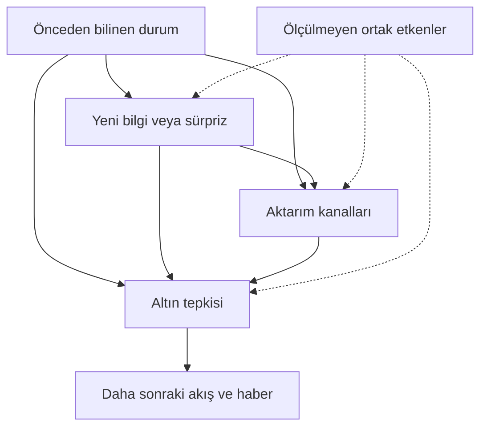

# Altında büyük hareketlerin mekanizma araştırması — bağımsız tasarım ve denetim

13 Ekim 2026. Araştırma kapsamı: neden–sonuç mekanizmaları, karşı örnekler ve veri uygunluğu. **Al-sat modeli, kârlılık hesabı veya doğrulanmış erken uyarı üretilmedi.**

## Karar

**Evet, yanlışlanabilir bir olay zinciri araştırması tasarlanabilir. Hayır, mevcut dosyalar tekrar eden ve önceden güvenilir biçimde ayırt edilen bir nedensel zinciri henüz göstermiyor.**

En uygun başlangıç, **kısıtlı zamansal yapısal nedensel modelin yönettiği, önceden gözlenen duruma koşullu olay çalışmasıdır**. Ana kestirim aracı küçük, hiyerarşik ve durum etkileşimli yerel projeksiyonlar; ilk eşik geçişinin zamanı/yönü için ikincil ölçüm aracı competing-risks olay geçmişidir. Haber bilgi grafiği kanıt kayıt katmanıdır. Hawkes, otomatik DAG keşfi ve sonuçlardan çıkarılan gizli rejimler başlangıç mimarisine eklenmemelidir.

Bu seçim şu ayrımı korur: **hazırlık koşulu** bir şoka duyarlılığı değiştirebilir; **yeni bilgi** şoku başlatabilir; **fonlama/pozisyon yapısı** etkiyi büyütebilir. Haber gelmeden hazırlığı bilmek, haberin geleceğini bilmek değildir. Tek bir tarihsel fiyat yolu bu üç etkiyi kendiliğinden ayıramaz.

## 1. Kaynak denetimi ve kapsam

Çalışma başlangıcında uzaktaki ana dal `4ecdf810e4e76fba37d20b4a94d30d0bc54b30a3`; PR #118 `1893fcdfeb91ca3e20165fa5f044ccf42dcefec3`, #119 `e1ead36ec670368dc6688f13179cf97cc6b05a25`, #120 `2e4f11348470ca99b43ba13c477dffc9a247bcc1` olarak doğrulandı. Üçü de açık/birleştirilmemişti. Bu dal doğrudan ana HEAD'den açıldı; mevcut dosyalar değiştirilmedi.

İlk kaynak #120'deki `GOLD_EVENT_CHAIN_ASTRA_HANDOFF_COMPLETE_INDEX_20261013.md`; ardından V2/V3/V4 raporları, ilgili CSV/JSON'lar, iki hakem raporu ve yeniden üretim kodu/SQL'leri incelendi. `input_inventory.json` okunan araştırma girdilerinin tam commit ve SHA256 envanteridir. Ana manifestin olay araştırmasına ilişkin güncel bölümleri de incelendi; eski tahmin projelerinin tamamı yeniden denetlenmedi. **Neon ham fiyat tabloları veya tüm orijinal haber arşivleri bu oturumda yeniden çekilmedi.** Sayısal tekrar, commit edilmiş türetilmiş verilerin denetimidir; ham kaynak doğrulaması değildir.

| Bulgu | Bu denetimdeki hüküm |
|---|---|
| 774 gün, 151 birincil +23 ek gün | CSV alanlarından bağımsız aritmetik tekrar başarılı |
| V3 ölçekli z5 sayıları 19/21/24; birleşim 24/26/30 | Tekrar başarılı; 24 küme, 24 ekonomik neden demek değil |
| V3 sonraki 10 kapanış ilk geçişleri | 764 tam pencerede verilen fiyatlardan yeniden hesaplandı; uyumsuzluk 0 |
| H03 2020–22 EV 0,4728; HistData 0,4740; 2023–25 0,6830; 2026 0,5173 | Türetilmiş CSV'den tekrar başarılı; koşullu ilişki, nedensellik değil |
| H03 evrensel yön ilişkisi | Veriler desteklemiyor; farkların nedeni otomatik olarak “rejim” diye tanımlanamaz |
| H05 aralık genişlemesi AUC ~0,89 | Seçilmiş küçük alt örneklem; yalnız dört karşılaştırılabilir epizod; doğrulanmış mekanizma değil |
| H15 gerginlik × anlatı tersine dönüşü | Bağımsız/kör haber etiketleri yok; sınanmış değil |
| “249 eksiksiz makro açıklama” | Yanlış: en az 5 resmî açıklama eksik; aşağıdaki pilotta kanıtlandı |
| “Sızıntısız” hakem kontrol seçimi | Geleceğe koşullu seçim içeriyor; geçerli karşı-olgusal kontrol değil |
| 2016–19 LBMA 12:00 serisi | Kaynak kimliği ve saat doğrulaması başarısız; ayrı karantinada tutulmalı |

### Yeni ve önemli düzeltmeler

**1 — Negatif kontrol evreni kirlenmiş.** Resmî arşivlerdeki 8 Ocak 2016 NFP, 20 Ocak 2016 CPI, 4 Eylül 2020 NFP, 11 Eylül 2026 CPI ve 16 Eylül 2026 FOMC, 249 satırda yok. Beşinin de aynı günü 1.429 kontrol adayının içinde. Mevcut ±1 takvim günü kuralıyla **12 aday tarih** bu beş eksikten etkileniyor. `calendar_exceptions.csv` resmî bağlantıları ve UTC zamanlarını içerir. Bu, kapsamlı takvim onarımı değil, asgari doğrulanmış hata kümesidir. BLS'nin 4 Eylül 2020 sayfası sonradan yeniden yayımlandığını da belirtiyor: açıklama zamanı doğrulanması, tüm içerik alanlarının ilk baskı olduğunun kanıtı değildir. [R1–R5]

**2 — “FOMC” tek bir müdahale değil.** 2020 satırlarında 15 Mart acil karar, 19 Mart swap hatları ve 27 Ağustos çerçeve iletişimi de var. Bunları olağan takvimli toplantıların dışsallığıyla ele almak yanlış. Acil kararın kendisi piyasa stresine tepkidir; şok ile altın arasında stres karıştırıcıdır. Statement/press conference/minutes/acil likidite/strateji iletişimi ayrılmalı. [R6,R7,R8]

**3 — Kontrol düzeltmesinde yeni seçim yanlılığı.** PR #119 kodu `ge[ci + 1:min(n, ci + 31)].any()` ile sonraki 30 seansta gerginlik yaşayan adayları çıkarıyor. Eski kural da gelecek ±5 günlük gerginliğe bakıyor. Bu filtreler gelecekteki altın yoluna koşulludur. Kontrol gününün geleceği bir sonraki rallinin oluşumuna katkı yapabilir; bu durum tek başına o günü geçersiz kontrol yapmaz. Doğru çözüm geleceği görerek bu günleri silmek değil, başlangıçta uygun bütün risk kümesini korumak ve zamansal bağımlılığı hesaba katmaktır. “Epizod sonu+20 gün” de ancak geriye dönük bir açıklama penceresi olabilir; önceden sabit ufkun yerine geçemez.

**4 — LBMA saati yalnızca farklı değil, etiketi şüpheli.** Resmî altın ihaleleri Londra 10:30/15:00'te; 12:00 gümüş ihalesidir. Bu nedenle StakTrakr satırındaki 12:00'u doğrulanmış altın fixing'i diye adlandıramayız. Ham seri kimliği/AM–PM/iş günü kaydırması incelenmeden 2016–19 nedensel veya fiyat-saat analizi yapılmamalı. Düşük çapraz kaynak korelasyonu tek başına farklı fixing saatiyle açıklanmış sayılamaz. [R9]

**5 — NY17 sınır koşulu.** PR #120 SQL'i `bar_end New_York + 7 hours` tarihini alıyor. Tam 17:00'te biten bar ertesi güne geçiyor; cuma son barı cumartesi filtresinde kalabilir. `audit.py` kış/yaz sınır örnekleriyle bunu gösteriyor. Gerçek sağlayıcıda bu bitiş zamanına sahip kaç bar olduğu incelenmedi: bu nedenle bütün serinin bir gün yanlış olduğunu iddia etmiyoruz. Yeni sözleşme, kapanış dahil `(önceki 17:00, bugünkü 17:00]` aralığı ve gerçek bar bitiş zamanını açıkça tanımlar.

**6 — Araştırma vintajı ile tarihsel gözlenebilirlik farklıdır.** 2026'da derlenen USMPD, 2020'de yayımlanmış hazır gösterge değildi. Ancak geçmişte işlem görmüş fiyatlardan ölçülen açıklama çevresi şoku, tarihsel olay çalışmasında kullanışlı olabilir. Şok ölçümü t+20 dakikayı kullanıyorsa t−1'de biliniyormuş gibi öncü değişken olamaz; t−10→t+20 tepkiyle birlikte kullanımı da araç değişkeninin dışsallığı kanıtı değildir. Bu ayrım veri kaynağını topyekûn reddetmekten daha doğrudur. [R8]

**7 — Eksik ölçüm, mekanizmayı çürütmez.** Nominal 10Y tahvil vadeli fiyatı ZN, reel faiz değildir. ZN'nin zayıf ayırıcılığı reel faiz kanalını reddetmez. Opsiyon OI tek başına piyasa yapıcısının gamma işaretini vermez. COT yayımlanmadığında pozisyonun araştırmacıya görünmemesi, gerçek pozisyonun fiyatı etkilemediği anlamına gelmez. Warsh vakası da tek başına “doğal deney” değil: beklenti, haber sızıntısı, dolar ve pozisyon çözülmesi aynı anda değişebilir.

**8 — Büyük harekete koşullamak seçim etkisi yaratabilir.** Şok, ön durum ve volatilite birlikte “büyük hareket” seçimini etkiliyorsa yalnız seçilen günlerde bu değişkenler yapay biçimde ilişkili hale gelebilir (collider/selection bias). Bu, 0,683 sayısının aritmetiğini yanlış yapmaz; nedensel veya tüm günlere taşınabilir yorumunu engeller. Aynı şekilde örtüşen gelecek pencerelerinin yarattığı bağımlılık, bilgi sızıntısıyla aynı sorun değildir; ikisi ayrı düzeltilmelidir.

## 2. A–B: Mekanizma sınıfları ve ölçülebilir zincirler

Haber başlıkları yerine **aktarımı farklı olan mekanizma aileleri** kullanılmalı. Bir olay birden çok aile taşıyabilir; zorunlu tek sınıf ataması yapılmamalı.

| Aile | Ön durum → şok → ölçülebilir aktarım | Ayırt edici karşı kanıt |
|---|---|---|
| Para politikası ve ekonomik bilgi | Ön politika yolu/pozisyon → sürpriz karar veya makro veri → OIS/TIPS/USD değişimi → altın | Aynı faiz artışı büyüme bilgisi de taşıyabilir; aynı politika sürpriziyle aynı tepki şart değil |
| Güvenli varlık ve kurumsal güven | Ön tehdit/rezerv tercihi → tehdit, eylem, yatışma veya kurum haberi → risk primi/kur/faiz bileşimi → altın | Tehdit zaten fiyatlanmış; eylem beklenenden sınırlı; başka piyasada nakit talebi baskın |
| Fonlama ve zorunlu satış | Kaldıraç/likidite darlığı → teminat veya fonlama şoku → satış akışı/derinlik azalması → altın satışı | Yalnız VIX artışı zorunlu satış kanıtı değil; birden çok bağımsız fonlama göstergesi gerekli |
| Fiziki yer/teslimat kısıtı | Mevcut stok ve taşıma kapasitesi → tarife/teslimat haberi → vade uyumlu EFP ve lease farkı → sevkiyat, göreli fiyat | Genel fiyat artışı olmadan EFP genişleyebilir; stok artışı net dünya talebi değildir |
| Pozisyon ve opsiyon büyütmesi | İşaretli pozisyon/strike yoğunluğu → ilk şok → hedge veya stop akışı → doğrusal olmayan tepki | Müşteri/dealer tarafı bilinmeden “negatif gamma” denemez; margin artışı volatilitenin sonucu olabilir |
| Yavaş talep ve marjinal alıcı | Kamuya o tarihte açıklanan rezerv/ETF/Asya talebi → talep tercihi değişimi → daha kalıcı fiyat duyarlılığı | Fiyat artışı rezervin dolar değerini artırır; alım miktarı yerine değer kullanılamaz; yayın gecikmeleri büyük |

“Anlatının tersine dönmesi” yedinci bağımsız ekonomik güç değil, yukarıdaki ailelerden birine ait **beklenti revizyonu işaretidir**. Önceden belgelenmiş anlatı olmadan REVERSES etiketi verilmez. Şaşırtıcılık yoksa yalnız yeni başlık bir şok sayılmaz.

Para politikasındaki politika/bilgi ayrımı [R10], fonlama–piyasa likiditesi geri beslemesi [R11], jeopolitik tehdit/eylem ayrımı [R12,R13] bu sınıflandırmayı destekler. Ancak bunlar bu veri setinde zincirin her okunu tanımlamaz. Merkez bankası altın birikimi ile dolardan uzaklaşma konusunda IMF ve Fed araştırmaları farklı vurgu yapıyor; evrensel “dedolarizasyon” etiketi verilmeyecek. [R14,R15]

## 3. C: Ana mimari ve tanımlama sınırları

### Zamana açılmış SCM

`S_i`: olaydan hemen önceki durum; `E_i`: yeni bilgi/sürpriz; `M_i`: olay sonrası aktarım göstergeleri; `Y_i(h)`: altın tepkisi; `U_i`: gözlenmeyen ortak etkenler. Her düğüm saat/vintaj ile tanımlanır.



Bu bir **hipotez grafiği**, veriden kanıtlanmış DAG değil. Aynı 15 dakikalık bar içindeki karşılıklı fiyat/akış tepkisi yönlendirilemez; ayrı anlık blok veya belirsiz kenar olarak kalır. Sonraki haberin geçmiş hareketi açıklaması, önceki tetikleyici olduğu anlamına gelmez.

Yapısal gösterim:

\[
E_i=f_E(S_i,U_i,\epsilon_i^E),\quad
M_i=f_M(E_i,S_i,U_i,\epsilon_i^M),\quad
Y_i(h)=f_{Y,h}(E_i,M_i,S_i,U_i,\epsilon_i^Y).
\]

Ana nedensel hedef, ancak tanımlama varsayımları savunulabiliyorsa:

\[
\tau_h(s;e,e_0)=E[Y_i(h;do(E=e))-Y_i(h;do(E=e_0))\mid S_i=s].
\]

“Haber olmasaydı” belirsizdir: FOMC için `e0=beklenen karar/beklenen iletişim`, CPI için `e0=önceden ölçülen beklentiye eşit ilk açıklama` gibi somut bir karşılaştırma gerekir. Bütün jeopolitik haberler tek bir değiştirilebilir müdahale değildir.

### İlk kestirim: durum etkileşimli olay yerel projeksiyonu

\[
Y_i(h)=\alpha_{k,h}+b_{era,h}+\beta_{k,h}E_i+
\theta_{k,h}^{\top}(E_i S_i)+\gamma_h^{\top}S_i+\varepsilon_{i,h}.
\]

`k` önceden tanımlı şok ailesidir. İlk pilotta tek aile ve çok az etkileşim kullanılır. Hiyerarşik kısmi havuzlama küçük örneklem varyansını düzenler; yeni bilgi veya nedensellik yaratmaz. Şokun pozitif/negatif işaretine ayrı eğim yalnız önceden belirlenmiş asimetri hipotezinde kullanılır. Zayıf tanımlanan büyük model yerine sürekli tepki ve belirsizlik raporlanır. Durum bazlı yerel projeksiyonların da ek tanımlama varsayımları vardır; ekonomik durumu sonradan sonuçlarla seçmek yasaktır. [R16,R17]

**Toplam etki denklemine olay sonrası USD/reel faiz/ETF akışı kontrol diye eklenmez.** Bunlar aracılar olabilir; eklenmeleri araştırılan etkinin bir bölümünü kapatır. Önce toplam şok etkisi; ayrı denklemlerde `E→M` ve zaman sıralaması. Nedensel aracılık payı ancak aracı–sonuç karıştırıcılarının da ele alınabildiği daha güçlü tasarımda tahmin edilir. Şimdilik “şok sonrası bu kanal da hareket etti” ölçülebilir; “etkinin %x'i bu kanaldan” kanıtlanamaz.

### Büyük hareketin zaman/yönü: ikincil olay geçmişi

Altın fiyatı `P`, sabit başlangıç `t0`, eşik `a=0,03` için:

\[
T^+=\inf\{u>0:P_{t0+u}/P_{t0}-1\ge a\},\quad
T^-=\inf\{u>0:P_{t0+u}/P_{t0}-1\le-a\}.
\]

`T=min(T+,T−)`, ilk yön `J∈{UP,DOWN}`. `T>H` ise NONE; veri `H`'ye ulaşmıyorsa **sağ sansür**, NONE değil. %5 ayrı ikincil eşiktir. Farklı başlangıç fiyatlarından zirve/dip seçilmez.

Zaman bölmesi `j` için aynı risk kümesinde:

\[
q_{k,j}=\frac{\exp(\eta_{k,j})}{1+\exp(\eta_{+,j})+\exp(\eta_{-,j})},\quad
S_j=\prod_{\ell\le j}(1-q_{+,\ell}-q_{-,\ell}),\quad
F_k(H)=\sum_{j\le H}S_{j-1}q_{k,j}.
\]

Böylece `F_UP+F_DOWN+S_H=1`. NONE üçüncü bir “ölüm nedeni” değil, o ufka kadar geçiş olmamasıdır. İlk geçişten sonra ters yöndeki geçiş ayrı çok durumlu devam kaydıdır; aynı bar iki bariyeri aşarsa sıra bilinmiyor diye işaretlenir. Aalen–Johansen betimsel başlangıç olabilir; **cause-specific** kelimesi ekonomik nedensellik kanıtı değildir. [R18]

Öncü kullanım için yalnız `t0−` geçmişi; haber sonrası güncelleme için bilginin gerçekten ulaştığı `t0+latency` sonrası yeni landmark. Bilinmeyen gelecekteki tetikleyici veya aracı yola konulmaz. Güncellenen koşullu olasılık, haberden önceki tahmin olarak sunulmaz.

### Alternatifleri neden şimdi seçmiyorum?

| Yöntem | Uygun rol / temel engel |
|---|---|
| Olay bilgi grafiği + NLP | Kaynak, iddia, düzeltme ve saatleri bağlar; çıkarılan kenar causal değil “kaynak iddiası”dır |
| Marked Hawkes | Yoğun ve eksiksiz haber/emir akışında tetiklenme örüntüsü; seçilmiş 53 kümede uygun değil. Ortak haber ve rejim kayması sahte öz-uyarım üretebilir [R19] |
| Rejim/değişim noktası | Ön veriden filtrelenen duyarlılık değişimi; tam seriyi yumuşatarak bulunan rejim öncü olamaz. İlk pilotta sürekli ön durumlar yeterli |
| PCMCI/SCM keşfi | Kısıtlı aday kenar üretimi; nedensel yeterlilik, sadakat, doğru gecikme/örnekleme varsayımları finansal veride ağır. Gizli değişkenleri modellemek onları giderdiğini kanıtlamaz [R20] |
| Bayesian event study | Ana yaklaşım için uygun belirsizlik/kısmi havuzlama; posterior yüksekliği müdahale tanımlamasının yerine geçmez |
| DiD/sentetik kontrol/BSTS | Dünya çapında Fed şokunda “etkilenmemiş altın” yok. Gümüş/petrol/USD de etkilenebilir. EFP'de göreli yer etkisi incelenebilir, fakat arbitraj spillover'ı ve paralel trendler sınanmalı [R21] |
| Doğal deney / yüksek frekanslı araç | İlk öncelik; açıklama çevresindeki beklenmeyen bileşen, eşzamanlı bilgi şoku ve ön sızıntı kontrolleriyle. “Planlı tarih” otomatik dışsal sürpriz değildir [R8,R10] |

Gizli karıştırıcılar için: alternatif DAG'lar, olay öncesi placebo, ölçülebilir güçlü karıştırıcıya göre duyarlılık sınırları, dışsal araç varsa zayıf araç sağlam çıkarım, veri kaynağına göre tekrarlama. OLS yerel projeksiyonlarında Cinelli–Hazlett türü robustness value; nonlinear hazard için ayrıca uygun duyarlılık modeli gerekir. “Latent state ekledik, nedensellik çözüldü” denmeyecek. [R22]

## 4. D: Veri ve zaman sözleşmesi

**İki örnekleme evreni:** (i) altın sonucuna bakmadan seçilen bütün uygun haber olayları; (ii) önceden sabit takvimli bütün uygun risk başlangıçları. İlkinde şok aktarımı, ikincisinde hareket oluşmaması dahil eşik geçişi araştırılır. İkisi aynı gözlem sayısı gibi birleştirilmez.

| Bileşen | Başlangıç tanımı |
|---|---|
| Ön durum | Önceki tamamlanmış seans; fiyat 5/20 gün, volatilite 60 gün; habere kadar doğrulanmış pozisyon/fonlama; haber için önceki 5 işlem günlük sabit kaynak sepeti |
| Ana olay tepki penceresi | İlk pilotta olağan FOMC statement `−15→+15 dakika`; M15 uç noktaları tam eşleşirse. `−60→−15` placebo; `+15→+120` devam ikincil ve basın toplantısı bulaşması işaretli |
| Diğer haberler | Tetikleyici kesin saati; M15 çözünürlüğünden daha ince nedensel sıra iddiası yok. Gece/tatil haberinde ilk açık piyasa fiyatına kadar bilgi birikimi ayrı |
| Sürekli sonuç | Yüzde/log getiri tanımı açık; yön, büyüklük, yayılım, kalıcılık ve tersine dönüş; max/min aralık yönlü getiri değil |
| Eşik sonuç | İlk %3 geçiş ve 10 gerçek işlem seansı ana; %5 ve 20 seans ikincil; 1h/4h/12h süreleri takvim zamanı, veri boşluğu doldurulmaz |
| Normalizasyon | Başlangıçta dondurulmuş volatilite; günlük `sqrt(H)` yalnız yaklaşık ölçek, kalibre kuyruk olasılığı değil; intraday için seans içi mevsimsellik ayrıca |
| Yayın zamanı | `event_occurs_at`, `first_published_at`, `updated_at`, `effective_at`, `market_observed_at`, `ingested_at`, `vintage` ayrı |
| Haber kanıtı | URL, publisher, arşiv sürümü/hash, orijinal/kopya, zaman kesinliği, çelişkili kaynak; URL'deki tarih tek başına ilk baskı kanıtı değil |
| Piyasa zamanı | UTC sakla; America/New_York, Europe/London, Europe/Istanbul ile dönüştür. 2016 Türkiye saat rejimi dahil tarihsel tzdata kullan |

COT için salı referans tarihi ile gerçek yayın tarihi farklıdır; tatiller ve 2025 kesintisi resmî takvimden işlenir. Son yayımlanmış veri yaşını da taşı. Ekim 2025'te sonradan yayımlanan pozisyonu o günkü ön durum yapma. LBMA ihale başlangıcı ile nihai fiyatın yayımlanma anı da aynı alan değildir. [R9,R23]

ETF AUM artışı akım değildir: fiyat değerlemesinden arındırılmış pay/ons ve yaratım–itfa gerekli. CFTC stocks/net longs yayınlanmış seviyeler; net akış için değişim ve rapor gecikmesi ayrı. EFP'de aynı vade, finansman/taşıma, teslim yeri/kalitesi gerekir; basit futures−spot otomatik EFP ölçüsü değildir. TIPS faizi saf politika beklentisi değildir; likidite primi şiddetli stres sırasında değişebilir.

Veri yokluğu sıfır akım veya sıfır şok olarak doldurulmaz. “Haber bulunamadı” ile “haber yoktu” ayrı. Sayfa-tarih belirsizliği için earliest/latest yayımlanma aralığı saklanır; aralık tepki başlangıcını kesiyorsa precursor statüsü verilmez.

## 5. E–F: Öncelikli hipotezler, kontroller ve yanlışlama

| Hipotez | Gerekli girdi / bugünkü uygunluk | Kontrol ve yanlışlama |
|---|---|---|
| M1: Aynı büyüklükte politika sürprizinin altın etkisi ön fonlama durumu ve politika/bilgi ayrımına bağlıdır | USMPD kamu arşivi mevcut; repo M15 ile olay uç noktaları/mediatör kapsamı birleştirilecek. Henüz uygun birleşik panel yok | Bütün olağan açıklamalar, küçük/sıfıra yakın ve ters işaretli sürprizler. Ön dönem placebo; açıklama/basın toplantısı ayrımı; bir yılı/krizi çıkarma; beklenen aktarım gerçekleşmiyorsa kanal iddiasını zayıflat |
| M2: Fonlama şoku güvenli liman talebini kısa süreli tersine çevirir | Bid–ask/derinlik, repo/cross-currency basis, margin duyuru+etki saati, OI/işlem akışı eksik | Benzer ön volatilitede fonlama stresi olmayan risk-off olayları. Yalnız fiyat düşüşüne bakarak “likidasyon” etiketi verilmez; önceden fonlama göstergesi yoksa öncü iddia reddedilir |
| M3: Yükselişi destekleyen belgeli anlatıyı tersine çeviren sürpriz, ön gerginlikte daha güçlü aşağı tepki yaratır | H15 kodlaması 0/249; kör metin ve beklenti büyüklüğü gerekli | Tension × reverses dört hücrenin hepsi, devam/ilgisiz/UNKNOWN dahil. Etkileşim, iki ana etkinin ötesinde olmalı; altın ifadelerini maskele; anlatı ufku ve kaynak sepeti duyarlılığı; büyük hareket olmayan ters haberleri mutlaka koru |
| M4: Teslim yeri/tarife şoku önce göreli EFP/lease farkını, sonra yer değiştiren stokları etkiler | Tarihli eş vade EFP, CME stok bildirimi, lease ve sevkiyat gecikmeleri gerekli | Altın seviyesi ana sonuç değil, göreli basis ana sonuç. Benzer lojistik fakat farklı tarife maruziyeti; fark haberi öncelemişse sürpriz iddiası zayıflar; gümüşü kendiliğinden etkilenmemiş kontrol sayma |
| M5: Tehdit/eylem/yatışma etkisi, ön beklenti ve fonlamaya bağlıdır | GPR sınıfları yararlı; günlük indeks intraday ilk haber yerine geçmez | Aynı çatışma ve ön risk içindeki gerçekleşmeyen tehditler, sınırlı eylemler, ateşkesler. “Eylem < tehdit” evrensel kabul edilmez; tek savaşın sonucu çıkarılınca kalmalı |
| M6: Pozisyon/gamma yapısı aynı dışsal şoku büyütür | OI/IV/strike/vade yetmez; taraf işareti/hedge maruziyeti gerekir | Benzer dışsal şok + farklı ön maruziyet; rollover/expiry placeboları; gamma işareti belirsizse senaryo sınırı, nokta iddia yok |
| M7: Yavaş talep yapısı politika duyarlılığını değiştirir | Rezerv miktarı/ETF/Asya talebi vintage ve yayın gecikmeleri eksik | Aynı faiz sürprizleri farklı ön talep dönemlerinde; miktar/değer ayrımı; gecikmeli duyurularla gün içi neden kurma; pandemi/2025 tek dönemine bağımlılığı göster |

**Şimdi sınanabilen:** türetilmiş fiyat aritmetiği, koşullu H03'ün aktarılmaması, takvim kapsama hataları, sızıntılı seçim ve zaman sınır kuralları. Bunlar çalıştırıldı. **Şimdi bilimsel mekanizma etkisi olarak sınanamayan:** M1–M7'nin tam neden–aktarım–sonuç zinciri. Yeni fiyat modeli kurmak bu eksikliği kapatmaz.

Kontroller, yalnız sonuçta hareket yapmadığı için seçilip nüfus kontrolü sayılamaz. Başlangıçta aynı risk kümesinden outcome-blind seçilir; sonradan NONE, ters yön ve devam alt grupları raporlanır. Etiketli vaka–kontrol alt örneklemesi yapılırsa örnekleme olasılıkları korunur; mutlak olay olasılığı doğrudan bu örneklemden hesaplanmaz. Gelecekte başka şok gelirse bu gözlem sessizce elenmez: toplam haber paketi etkisi veya yeni competing exposure olarak ele alınır; keyfî sansürleme bilgi taşır.

## 6. Sekiz zorunlu vakanın yeniden değerlendirmesi

**Bu bölüm geliştirme vakalarıdır; bağımsız başarı testi değildir.** Getiriler aksi belirtilmedikçe eski raporların aynı kaynaklı türetilmiş ölçümleridir, bu oturumda ham M15'ten yeniden üretilmiş sayılar değildir. Her dosyada gelecekte karşılaştırılacak kontrol adayları, sonuçlarına göre seçilmiş nihai eşleşmeler değildir.

| Vaka | Hazırlık → aday bilgi → kanal → tepki | Karşı kanıt ve karşılaştırma |
|---|---|---|
| Mart 2020 | Likidite/kaldıraç kırılganlığı → pandemi ve politika haberleri → nakit/teminat ihtiyacı → sert altın satışı | 2 Mart WGC uyarısı yön/tarih garantisi değildi; 19 Mart açıklaması geriye dönük. ETF desteği satışla birlikte vardı. 23 Mart Fed alımları sonrası evre ayrı müdahale. Başka risk-off ama fonlama sıkışmayan günlerle karşılaştır [R24,R25] |
| 24 Şubat 2022 | Önceden savaş tehdidi → işgalin ilk doğrulanmış haberi → haven ve USD/risk yeniden fiyatlaması → önce yükseliş, sonra geri dönüş | Kaynak paketi %5,129 high/low aralık ve −%0,22 kapanış getirisi veriyor. Aralık sıralı kazanç değildir. Sonraki yaptırım haberleri ayrı alt olay; tehdit günleri ve sınırlı eylem haberleri kontrol adayı |
| Mart–Nisan 2024 | Faiz/kur ve ön talep → 1 Mart ISM ve diğer bilgi → OTC/opsiyon/talep büyütmesi adayları → süren yükseliş | WGC 12 Mart tek açıklama bulamadığını, model artığı olduğunu söylüyor. Artık=merkez bankası alımı kanıtı değil. Mart ile Nisan'ı tek faiz rejimi yapma. Sıcak CPI'ye rağmen devam günleri güçlü karşı örnek [R26] |
| Ağustos 2024 | Carry/kaldıraç → BoJ ve ABD veri haberleri → çözülme/likidite → kısa süreli altın satışı | V4 %4,002 intraday aralık, −%1,275 kapanış veriyor; gergin r20 koşulu gerekli değildi. BIS genel piyasa çözülmesini destekler, altın satıcısının kimliğini kanıtlamaz. Diğer zayıf NFP günleri kontrol [R27] |
| Ocak 2025 | Tarife belirsizliği/yerel stoklar → tarife kapsamı haberleri → göreli premium/sevkiyat → NY–Londra ayrışması | Stok yer değişimi dünya çapında kıtlık demek değil; vade farkı ayrıştırılmalı. Ocak haberini 2 Ocak öncüsü yapma. Nisan muafiyeti mekanizma karşıt yön testi olabilir; otomatik doğal deney değil [R28] |
| Nisan 2025 | Fiziki dislokasyon ve risk → tarife, muafiyet, erteleme, kurum haberleri → ilk likidasyon/basis, sonra güven/kur → iki yön | Pakette 2–8 Nisan −%4,788, sonraki +%8,567 farklı pencereler. +%8,567'yi tek güne çevirme. Eşzamanlı açıklama paketini ayırmadan tek “tarife etkisi” hesaplama |
| Ekim 2025 | Uzun yükseliş ve oynaklık → ticaret beklentileri vb. adaylar → pozisyon çözülmesi → düzeltme | 13 Ekim WGC hem kırılganlık hem aşırı olmayan pozisyon diyor. Uyarı sonrası yükseliş sürüyor. COT ilk yayımlanma gecikmesi korunmalı; Kasım KDV yürürlüğü geçmiş tetikleyici olamaz. Aynı gerilimle yükseliş süren günleri koru [R23,R29] |
| Ocak 2026 | Uzun yükseliş ve Fed güveni anlatısı → aday spekülasyonu/Warsh haberi → USD/faiz/likidasyon adayları → sert düşüş | İlk görülen makale zaten düşüşü bildiriyorsa başlangıç tetikleyicisi olarak kullanılamaz. İlk söylenti, doğrulama ve resmî adaylık ayrı. Olay “dokunulmamış doğal deney” değil; diğer adaylık söylentileri de evrene alınmalı |

Bu vakalardaki ilk haberin kesin dakikası bilinmeyen yerde boş kalır. Haber başlığından geçmiş yön bilindiği için bu oturumda kör etiket üretildiği iddia edilmiyor.

## 7. G: Asıl gözden kaçan bilimsel araçlar

En önemli ilave daha büyük bir tahmin algoritması değil, **şoku tanımlama yöntemi**. Fed bilgi şoku ayrıştırması, bir faiz artışının neden farklı günlerde farklı anlam taşıdığını sınanabilir hale getirir. Kamuya açık USMPD aynı olay penceresinde OIS/TIPS/USD/hisse değişimleri sunuyor; tarih ve fiyat uç noktaları doğrulanarak M1 için maliyeti sınırlı bir başlangıç sağlar. [R8,R10]

İkinci ilave **koşullu etki ile olay oluşumunu ayırmak**, ama yalnız büyük olayları seçmemektir. İlk bariyer modelleri ve çok durumlu süreçler, NONE ile iki yönlü dönüşü görünür kılar. Üçüncü ilave **taşınabilirlik/parametre istikrarı sınamalarıdır**: aynı mekanizma katsayısının farklı dönemlerde davranışı, H03 AUC'si kadar önemlidir. İnvaryans bir yanlışlama aracı olabilir; invaryans bulunması tek başına nedenselliği kanıtlamaz. [R18,R30]

Dördüncü ilave, haber metnini “gerçek neden” kabul etmeyen **ölçüm-hatası modeli ve kanıt hiyerarşisi**. NLP tarih ve mekanizma iddiasını çıkarır; iki bağımsız kodlayıcı kör değerlendirme yapar; anlaşmazlık/UNKNOWN korunur. Tarihleri görmeyen LLM bile meşhur olayları eğitiminden hatırlayabilir. Gerçek bağımsız kanıt için bundan sonraki haberlerin sonuçları oluşmadan zaman damgalı kodlanması gerekir; bu, otomatik alarm kurmak anlamına gelmez.

## 8. H: Uygulanabilir aşamalar ve tamamlanan pilot

### Pilot 0 — bu oturumda tamamlandı

`audit.py` standart Python ile commit edilmiş girdileri okur; 774 günlük taramayı, V3 ilk geçişlerini ve H03 sayılarını tekrarlar; 5 eksik resmî açıklamayı, 12 kontrol takvimi çakışmasını, gelecek filtreli kontrol seçimini ve NY17 sınır örneklerini kaydeder. **Mekanizma katsayısı veya haber modeli uydurulmadı.**

| Dönem/kaynak | Uygun başlangıç | UP ilk | DOWN ilk | NONE | Herhangi bir geçiş | Koşullu H03 AUC |
|---|---:|---:|---:|---:|---:|---:|
| 2020–22 EV | 705 | 144 | 145 | 416 | %40,99 | 0,4728 |
| 2020–22 HistData | 703 | 151 | 141 | 411 | %41,54 | 0,4740 |
| 2023–25 EV | 764 | 286 | 85 | 393 | %48,56 | 0,6830 |
| 2026 HistData | 182 | 77 | 79 | 26 | %85,71 | 0,5173 |

Bunlar örtüşen gözlemler; bağımsız örnek veya yeni başarı oranı değil. 2026'da aynı %3 eşiğinin çok sık aşılması, sabit eşiğin başka bir olay yoğunluğu seçtiğini gösterir. Bunun sebebini yalnız rejim diye ilan etmiyoruz. 2016–19 0,5798 aritmetik olarak tekrarlandı ama kaynak kimliği nedeniyle yukarıdaki karşılaştırmaya alınmadı.

### Aşama 1 — veri kabul kapısı

1. Resmî Fed/BLS evrenini baştan tam say ve 249 tabloyla anti-join yap; sadece bulunan 5 satırı ekleyip “tamam” deme. Normal/acil politika sınıflarını ayır; kontrol takvimini yeniden oluştur.
2. NY17 bar sınırı, hafta sonu/tatil, 70 bar kuralının kısa seansları elemesi, uç nokta eskiliği ve aynı sağlayıcı eşleşmesini ham veride doğrula. 15m veriden 5m bulgu üretme.
3. USMPD şok ve mediatör alanlarının yıl/olay bazında eksiklik tablosunu çıkar. 2016–19 gold serisi fixing kimliği çözülene kadar engelli; mevcut aynı kaynaklı 2020–25 M15 ilk aday.
4. Beklenti/ilk açıklama/vintage için uygunluk matrisi; lisans izinleri. Tarihsel açıklama zamanı doğruluğu ile güncel veri indirme zamanını karıştırma.

**Geçiş ölçütü:** seçilen ailede resmî olay evreni tam hesaplanmış; her dahil edilen gözlemde doğru şok/altın uç noktası ve yayın kanıtı; tüm dışlama nedenleri, yıllık yön/volatilite farkları dahil listeli. Eksiklik çoksa sessizce elde kalanlarla nedensel analiz yok.

### Aşama 2 — ilk gerçek mekanizma pilotu: yalnız olağan FOMC

Veri kapısı geçtikten sonra **sonuçlara bakmadan** yalnız 30 dakikalık statement şoku, altın −15→+15 getirisi ve en fazla iki ön durum etkileşimini sabitle. Aynı gün basın toplantısı ayrı; acil 2020 duyuruları ana örnekleme karıştırılmaz. Hızlı faiz yolu ölçüsü ile politika/bilgi ayrımını önceden belirle. Şok tanımına altın fiyatını sokma. USMPD penceresi altın penceresiyle farklıysa yeniden ölç veya ayrı duyarlılık olarak raporla; aynı diye varsayma.

Somut başlangıç şartnamesi: aynı sağlayıcı 2020–2025 olağan FOMC statement evreni; `Y=100 log(P[t+15]/P[t−15])`; ön değişkenler son tamamlanmış seansta `sd60` ve `r20/(sd60 sqrt(20))`; şok ölçüsü USMPD'nin yaklaşık bir yıllık politika yolu sürprizi, ham bileşen ve pencere sürümü sabit. `E×sd60` ve `E×zr20` dışında etkileşim ekleme. Altın kullanılmadan faiz/hisse bilgisiyle politika–bilgi ayrımı önceden seçilmiş duyarlılık analizi olarak yürütülsün; ölçüm varsayımları açıklansın. Bu ilk tasarım fonlama kanalını doğrudan test etmiş sayılmaz; fonlama ölçümü hazır olduğunda M2 ayrı sınanır. Katsayıları görmeden olay sayısı/bağımlılığına göre güç veya beklenen aralık genişliği simülasyonu yapılsın; belirsizlik hedefi yetersizse daha karmaşık modele geçilmesin. Bu şartname **gelecek uygulama taslağıdır**, bu oturumda yapılmış dış kayıt veya geçmişteki hipotezlerden bağımsız önkayıt değildir.

Ana sürekli tepki bütün olayları içerir; büyük hareketler ikincil. Bir 30 dakikalık etkinin tek başına 10 günlük %3 hareketi açıklaması beklenmez. Makro mekanizma başarılı olsa bile yavaş demand/plumbing şoklarını açıklıyor sayılmaz.

Önceki yıllar zaten görüldüğü için 2020–25/2026 bölmesi **retrospektif tarihsel aktarım**dır. Yıllar arasında sürpriz büyüklüğü ve durum için ortak destek yoksa taşınabilirlik tahmini yapılmaz. Pozitif/negatif/sıfıra yakın şokları tut; karşılaştırma, rastgele seçilmiş sessiz gün yerine aynı açıklama ailesi içinde güçlü olsun. Sessiz günler placebo için yardımcıdır.

### Aşama 3 — H15 kör kodlama ve mikro yapı

M1'den bağımsız olarak tüm uygun haberler için iki aşamalı anotasyon: önce sadece olay öncesi kaynaklarla anlatı; ardından fiyat ifadeleri çıkarılmış ilk haberle yer değiştirme etiketi. Kaynak/kodlayıcı uyumu, UNKNOWN ve belirsiz zamanı raporla. EFP veya fonlama ailesini yalnız kendi ölçümleri hazır olduğunda ekle. Tüm aileleri aynı anda tahmin eden büyük bir sistem kurma.

### Aşama 4 — yanlışlama ve durdurma

Ön pencere etkisi, sahte açıklama saatleri, farklı güvenilir kaynak, 15m sınır kayması, tek büyük kriz/yıl çıkarma ve tam sonuç raporlama. Birincil aile/ufuk önceden sabit; ikincil testlerde çoklu karşılaştırma kontrolü. Takvim boyunca blok belirsizliği ve haber epizodu bağımlılığı; olay olmayan günleri attıktan sonra 20 satırlık blokların 20 seans sayılması yasak. Uzun örtüşme grupları tek dev gruba dönüşürse etkin bilgi azlığı açık yazılır; bootstrap yeni örnek yaratmaz.

Model başarısı: tahmini kazanç değil, önceden belirtilmiş kanalın ölçümlerdeki sırası, null/ters vakalara dayanıklılığı, dönemler arası etki belirsizliği ve gizli karıştırıcıya duyarlılığı. Negatif sonuç; düşük güç; ölçüm yetersizliği birbirinden ayrılır. Kanal katsayısı çöküyorsa mekanizma evrensel ilan edilmez; hikâye değiştirip aynı sonucu kurtarma yapılmaz.

## 9. Çıktı şeması ve yeniden üretim

Her vaka `event_record.schema.json` ile kaydedilebilir. Kaydın sonuç bölümü anotasyon ekibine verilmez. Destekleyici kaynak ile nedensel tanımlama derecesi farklı alanlardır. Haber olmayan tarih ile fiyat hareketi olmayan tarih farklıdır.

Çalıştırma (PR'ları birleştirmez):

```bash
git fetch origin gold-execution-channel-audit-20261006 research-claude-referee-multihorizon-atlas-v2-20261013 research-claude-referee-v4-event-chain-20261013 research-gold-event-chain-h15-2016-2026-test-20261013
python gold_axis_2026/causal_mechanism_research_20261013/audit.py
```

Kod yalnız kendi yeni dizinine `audit_results.json`, `calendar_exceptions.csv`, `descriptive_replication.csv`, `input_inventory.json` yazar. Ham vendor fiyatları kopyalanmadı. Referansların tarihi 13 Ekim 2026 erişimi; güncel web sayfalarının ilk baskı oldukları ayrıca kanıtlanmadıkça varsayılmadı.

**Nihai bilimsel hüküm:** Fonlama, politika beklentisi, kurumsal güven ve fiziki yer değişimi için güçlü ekonomik mekanizma adayları var. Mevcut sayılar bunların altın hareketlerinden önce sistematik, ayırt edilebilir ve tekrarlanabilir zincir oluşturduğunu henüz kanıtlamıyor. Önerilen mimari bu iddiayı karşı örneklerle sınayabilir; ilk ilerleme kapısı yeni bir tahmin modeli değil, düzeltilmiş olay evreni ve şok–aktarım zamanlarının ölçümüdür.
